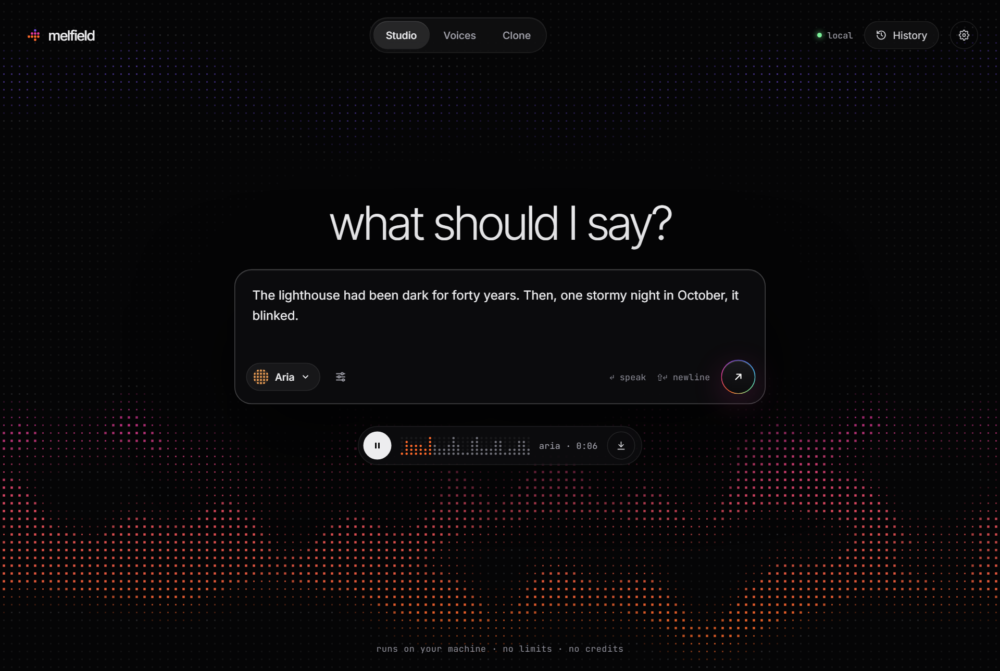
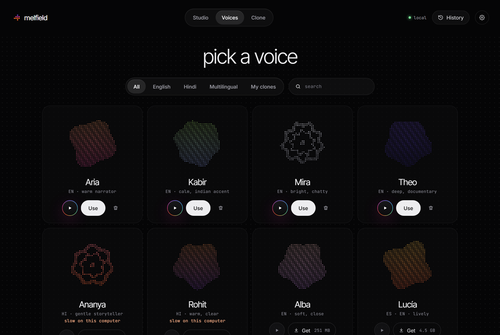
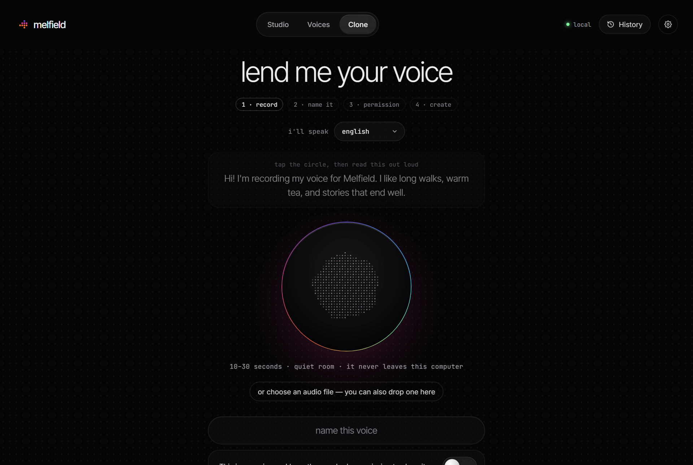

<p align="center">
  
</p>

<h1 align="center">melfield</h1>

<p align="center"><b>Every voice. On your machine.</b><br/>
Studio-quality text-to-speech and voice cloning that runs entirely on your computer.<br/>
Free, offline after download, no limits, no credits, no account.</p>

<p align="center">
  
</p>

## Why
Open voice models are excellent now — but using them means Python, CUDA, model cards and a terminal. Melfield hides all of that. Install it, open it, and hear a voice in about a minute.

- **Instant first voice.** Six built-in English voices run natively (no Python), on any computer.
- **Voices, not models.** Pick Aria or Kabir. Melfield chooses the right engine for your hardware.
- **Clone a voice** from 10–30 seconds of audio — with a consent switch and an inaudible watermark on everything a clone says.
- **Indian languages.** Hindi cloning, and 21 Indian languages through Indic Parler-TTS.
- **Unlimited text.** Paste a chapter: the first sentence plays while the rest renders.
- **Private by default.** No telemetry. The network is only used to download voices and updates.
- **For developers.** An OpenAI-compatible `/v1/audio/speech` endpoint on localhost (off by default) and a `melfield` CLI.

<p align="center">
  
  
</p>

## Voices
| Engine | Used for | License | Runs on |
|---|---|---|---|
| Kokoro-82M (native, via sherpa-onnx) | Built-in English voices | Apache-2.0 | Any CPU |
| Pocket TTS (Kyutai) | English voices + cloning without a GPU | CC BY 4.0 weights, MIT code | CPU |
| Chatterbox Multilingual v3 / Turbo (Resemble AI) | Cloning in 23 languages incl. Hindi | MIT | GPU, Apple Silicon, CPU (slow) |
| Qwen3-TTS (Alibaba) | Cloning in 10 languages, built-in speakers | Apache-2.0 | GPU / Apple Silicon |
| Indic Parler-TTS (AI4Bharat) | 21 Indian languages | Apache-2.0 (gated) | GPU, CPU (slow) |
| VoxCPM2 (OpenBMB) | High-fidelity cloning, 30 languages | Apache-2.0 | GPU ≥ 8 GB |

Weights are never redistributed: each voice is downloaded from its original source, pinned to an exact revision and checksummed (`registry/recipes/`). Licenses travel with every voice and are shown in the app.

## Status
v0.1 — first public build.

| | |
|---|---|
| Windows 11 | App, built-in voices, Pocket TTS (Python engine), watermarking: verified on real hardware |
| macOS / Linux | Builds in CI; awaiting first hands-on testing |
| Chatterbox, Qwen3, Indic Parler, VoxCPM2 | Integrated; awaiting verification on a GPU machine |
| Installers | Unsigned for now (Windows SmartScreen / macOS Gatekeeper will warn) |
| MP3 export | Not yet — WAV and FLAC |

## Build from source
Prerequisites: Rust (stable), Node 22, [uv](https://docs.astral.sh/uv/).

```bash
cd app && npm install
```
```bash
scripts/fetch_uv.sh
```
```bash
cd app && npx tauri dev
```

Tests:
```bash
cargo test -p melfield-core -p melfield-api -p melfield-cli
```
```bash
uv run --no-project --with numpy --with pytest python -m pytest workers/tests -q
```
```bash
cd app && npm test && npm run test:ui
```

## Docs
- [Architecture](docs/architecture.md) — how the app, core, registry and engines fit together
- [Engine worker protocol](docs/protocol.md)
- [Local API & CLI](docs/api.md)
- [Third-party notices](THIRD_PARTY_NOTICES.md)

## License
Melfield's code is MIT — see [LICENSE](LICENSE). Each voice keeps its own license; see [THIRD_PARTY_NOTICES.md](THIRD_PARTY_NOTICES.md) and the voice details in the app.
